<p align="center">
  <picture>
    <source media="(prefers-color-scheme: dark)" srcset="./assets/hero-dark.svg">
    
  </picture>
</p>

# @utilitly/mcp

A PDF MCP server for Claude, Cursor and any other app that speaks the Model Context Protocol. Ask your AI to merge, split, rotate, delete, reorder or duplicate pages, and it does the work with PDF files on your own computer.

The server runs locally, next to the AI app, and edits files where they sit. It's built on Utilitly's open-source PDF engines, ported from the free tools on [utilitly.com](https://utilitly.com), and it never replaces a file: every result is a new PDF beside the original.

## Install

You need Node.js 22 or newer. The first run downloads the server through `npx`.

The folders after the package name are the only places the server may read and write. Change them to wherever your PDFs live.

**Claude Code**

```sh
claude mcp add utilitly -- npx -y @utilitly/mcp ~/Documents ~/Downloads ~/Desktop
```

**Claude Desktop**: open Settings, then Developer, then Edit Config, and add this to `claude_desktop_config.json`. Restart Claude Desktop afterwards.

```json
{
  "mcpServers": {
    "utilitly": {
      "command": "npx",
      "args": ["-y", "@utilitly/mcp", "~/Documents", "~/Downloads", "~/Desktop"]
    }
  }
}
```

**Cursor**: put the same `mcpServers` block in `~/.cursor/mcp.json`.

**Anything else** that can start a local (stdio) MCP server: the command is `npx` with the arguments `-y @utilitly/mcp`, followed by the folders.

### About the folder list

The check happens after symlinks are resolved, so a link inside an allowed folder can't lead somewhere else.

Leave the folders out and the server may use any file you can. It still never overwrites or deletes anything, and it never shows the AI what's inside a PDF. But an AI misled by something it read elsewhere could copy any of your PDFs into any folder, so list folders unless you need it everywhere.

## Try it in 30 seconds

Once it's installed, ask in plain words and use full paths:

- "Merge ~/Downloads/march.pdf and ~/Downloads/april.pdf."
- "Delete the blank page 3 from ~/Desktop/scan.pdf."
- "Split ~/Documents/handbook.pdf into pages 1-12, 13-30 and 31 to the end."
- "Pages 2 to 4 of ~/Desktop/scan.pdf are sideways; turn them the right way up."
- "How many pages does ~/Documents/contract.pdf have, and is it locked?"

## Tools

| Tool | What it does | New file it writes |
| --- | --- | --- |
| `pdf_info` | Page count, file size, first page size, and whether the PDF is password-protected. Changes nothing. | none |
| `merge_pdfs` | Combines PDFs in the order given. | `<first>-merged.pdf` |
| `split_pdf` | One file per range, e.g. `"1-2, 3-end"`. | `<name>-part1.pdf`, `-part2.pdf`, … |
| `extract_pages` | The selected pages as one PDF, in page order. | `<name>-pages.pdf` |
| `rotate_pdf` | Turns pages by a multiple of 90 degrees. | `<name>-rotated.pdf` |
| `delete_pages` | Removes pages; at least one has to stay. | `<name>-trimmed.pdf` |
| `reorder_pages` | Puts every page in a new order. | `<name>-reordered.pdf` |
| `duplicate_pages` | Adds copies after each page or at the end. | `<name>-duplicated.pdf` |

Results land in the same folder as the input. Every writing tool also takes an optional `output_path`, and `split_pdf` an optional `output_folder`. Page selections read like `"2"`, `"1-3, 5"` or `"4-end"`.

Problems come back to the AI as a short code and a sentence it can act on, such as `NO_PAGES: "9" doesn't match any page. The PDF has 4 pages.` or `ENCRYPTED: File 2 is password-protected. Remove the password first, then try again.`

## What it can and can't touch

- It never overwrites. If `report-merged.pdf` already exists, the result becomes `report-merged-2.pdf`, and an `output_path` that already exists is refused.
- Input files are only read, never changed.
- Paths must be absolute or start with `~/`, so the AI can't stumble into the wrong folder through a relative path.
- With folders listed at install, nothing outside them can be read or written.
- Password-protected PDFs are refused rather than altered. `pdf_info` reports when a file is locked.
- One call can add at most 10,000 pages beyond what its input files hold, and one split writes at most 1,000 files (or one per page for longer PDFs). A mistaken request, like a hundred million copies, is refused before anything is built.

## Why nothing is uploaded

<p align="center">
  <picture>
    <source media="(prefers-color-scheme: dark)" srcset="./assets/no-network-dark.svg">
    
  </picture>
</p>

The PDF work happens inside this server, on your machine, with no network code anywhere in it. `test/network.test.ts` proves that on every change: it makes opening a connection, looking up a host name and calling `fetch` all throw, then runs every tool, and they all succeed.

Your AI app still talks to its model as usual. That conversation includes whatever you type, file paths included, and each tool's short reply: the paths it wrote, page counts and file sizes. This server never puts the contents of a PDF into the conversation.

## Good to know

- `merge_pdfs`, `split_pdf`, `extract_pages`, `delete_pages`, `reorder_pages` and `duplicate_pages` build fresh PDFs, so bookmarks, document properties and working form fields aren't carried into the result. `rotate_pdf` keeps the whole document.
- Images and fonts shared between pages stay shared, so results don't balloon in size.
- To check what's running, `npx -y @utilitly/mcp --version` prints the version and `--help` the usage.

## License

MIT. Built on the [@utilitly PDF engines](https://www.npmjs.com/org/utilitly) and [pdf-lib](https://github.com/Hopding/pdf-lib) (both MIT), and the official [MCP TypeScript SDK](https://github.com/modelcontextprotocol/typescript-sdk) (Apache-2.0).
